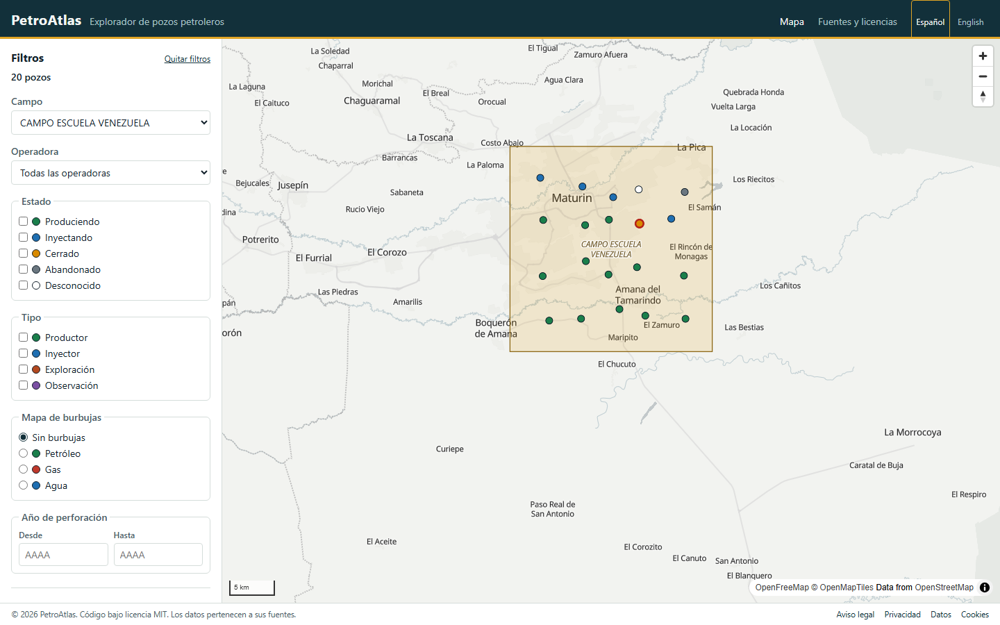
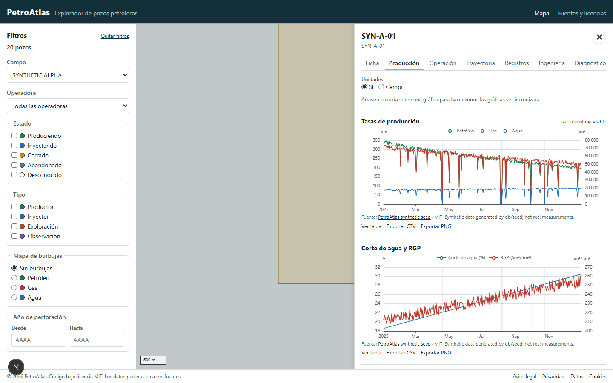
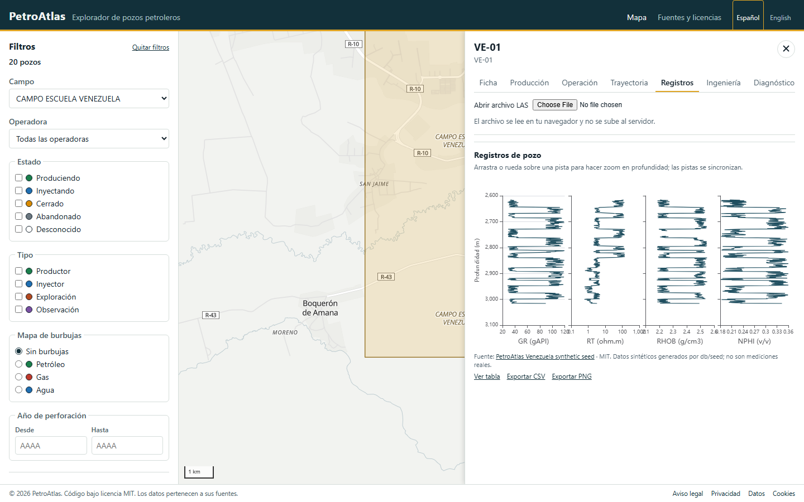
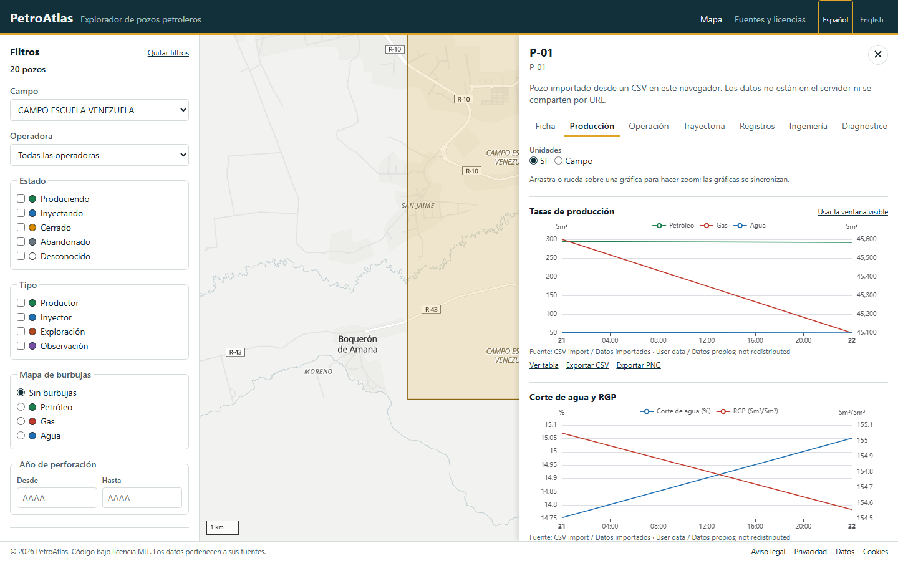
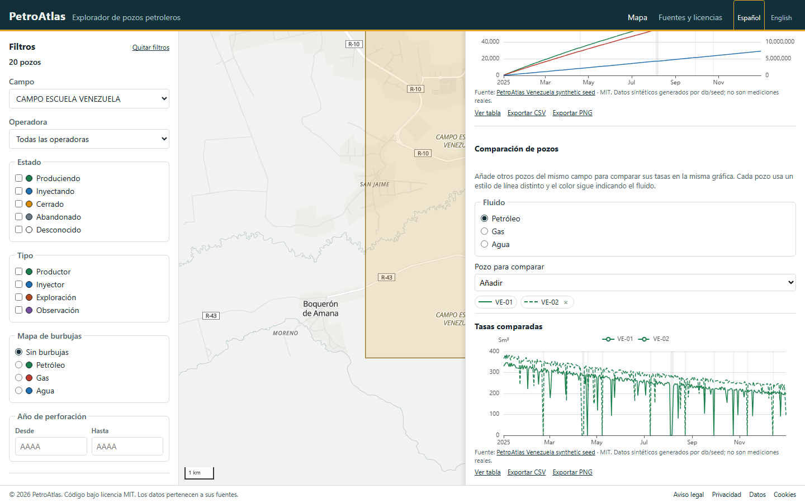
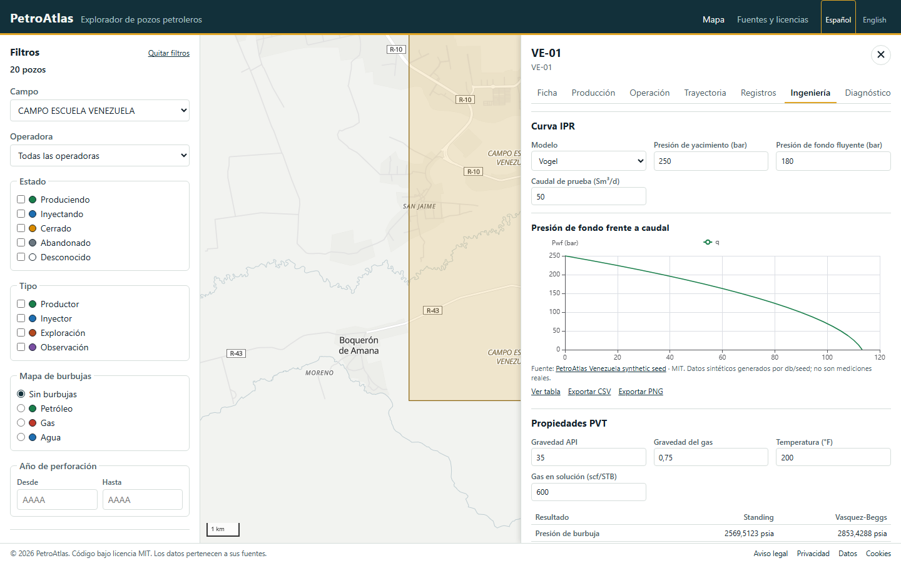
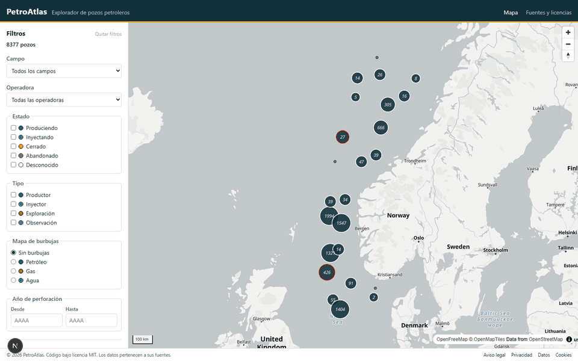

# PetroAtlas

Explorador web de pozos petroleros, de código abierto: un mapa como entrada, fichas con series de producción y presión, herramientas de ingeniería que calculan en el navegador e importación de datos propios en CSV. Disponible en español e inglés.

**Demo:** <https://petroatlas-web.onrender.com> · **API:** <https://petroatlas-api.onrender.com/api/health>

> **Estado: fase 4 completa.** Mapa con clustering, filtros y estado en la URL; fichas con producción, operación, trayectoria, registros, ingeniería y diagnóstico; alertas; comparación de pozos; importación CSV en IndexedDB; exportación CSV y PNG; páginas legales y revisión de accesibilidad con axe. `petro-calc` supera el 90 % de cobertura. Su versión `0.2.0` está preparada para publicarse como [`@suricatoaviones/petro-calc`](https://www.npmjs.com/package/@suricatoaviones/petro-calc). La demo pública corre en Render. El plan completo está en [docs/11-plan-de-fases.md](docs/11-plan-de-fases.md).



## Arranque rápido

Requisito: [Docker](https://docs.docker.com/get-docker/) con Docker Compose.

```bash
git clone <url-del-repositorio> petroatlas
cd petroatlas
docker compose up --build
```

Cuando termina de arrancar:

| Qué                  | Dónde                                         |
| -------------------- | --------------------------------------------- |
| Web con el mapa      | <http://localhost:3000>                       |
| Estado de la API     | <http://localhost:4000/api/health>            |
| PostgreSQL + PostGIS | `localhost:55432`, base de datos `petroatlas` |

`docker compose up` crea los usuarios de base de datos, aplica las migraciones y carga un campo sintáctico con 20 pozos, un año de producción diaria y registros de pozo. No hace falta ningún archivo `.env`: todos los valores tienen un valor por defecto de desarrollo. Para cambiarlos (puertos, contraseñas), copia `.env.example` a `.env`.

Para empezar de cero, borrando la base de datos: `docker compose down --volumes`.

## Cómo se usa

1. **Elige idioma.** La cabecera alterna entre español e inglés; el idioma forma parte de la URL (/es o /en) y se aplica a toda la interfaz y a las páginas legales.
2. **Explora el mapa.** Filtra por campo, operadora, estado, tipo o año de perforación; cambia el color de los pozos y activa el mapa de burbujas de acumulados. La vista queda en la URL y se puede compartir.
3. **Abre un pozo.** La ficha reúne metadatos, ubicación, series de producción y operación sincronizadas, trayectoria, registros por pistas, ajuste de declinación, IPR, PVT y diagnóstico de Chan. En Registros puedes abrir un archivo LAS local; se lee en el navegador y no se sube.
4. **Compara pozos.** En la pestaña Producción añade hasta ocho pozos del mismo campo. Cada pozo usa un estilo de línea distinto, el color sigue indicando el fluido y la selección viaja en el parámetro `comparar`.
5. **Importa tus datos.** En el panel de filtros, elige un CSV con el formato de [docs/09](docs/09-alertas-importacion-url.md). El archivo se valida fila a fila y se guarda en IndexedDB: no se sube al servidor. Los pozos importados aparecen en el mapa con otro símbolo y usan las mismas gráficas, alertas y calculadoras.
6. **Exporta.** Cada gráfica ofrece tabla, CSV de los datos visibles y PNG. La ficha descarga la serie completa del pozo en el mismo formato que acepta la importación.













## Desarrollo local

Requisitos: Node 26 (LTS, ver `.nvmrc`), pnpm 12 y Docker para la base de datos.

```bash
pnpm install
cp .env.example .env
pnpm exec playwright install chromium    # solo la primera vez, para las pruebas e2e

docker compose up --detach db db-setup   # base de datos, migraciones y datos sintácticos
pnpm dev                                 # API en :4000 y web en :3000, con recarga
```

| Comando              | Qué hace                                                               |
| -------------------- | ---------------------------------------------------------------------- |
| `pnpm dev`           | API y web en modo desarrollo                                           |
| `pnpm lint`          | ESLint y comprobación de formato con Prettier                          |
| `pnpm format`        | Aplica el formato de Prettier                                          |
| `pnpm typecheck`     | `tsc --noEmit` en todos los paquetes                                   |
| `pnpm test`          | Pruebas con Vitest; las de la API necesitan la base de datos en marcha |
| `pnpm test:coverage` | Cobertura de `petro-calc`; falla por debajo del 90 %                   |
| `pnpm test:e2e`      | Pruebas de extremo a extremo y de accesibilidad con Playwright         |
| `pnpm build`         | Compila paquetes, API y web                                            |
| `pnpm db:migrate`    | Aplica las migraciones pendientes de `db/migrations`                   |
| `pnpm db:seed`       | Carga los datos sintácticos; se puede repetir sin duplicar nada        |

Un cambio está terminado cuando `pnpm lint`, `pnpm typecheck`, `pnpm test`, `pnpm test:e2e` y `pnpm build` pasan. El resto de reglas está en [docs/12-convenciones.md](docs/12-convenciones.md).

## Arquitectura

```text
apps/web/               Next.js (App Router) + MapLibre + ECharts
apps/api/               Express 5: API REST de solo lectura
packages/petro-calc/    Cálculos de ingeniería en TypeScript puro
packages/shared-types/  Tipos y esquemas Zod compartidos
db/migrations/          SQL versionado
db/seed/                Generador de datos sintácticos
db/init/                Creación de usuarios al inicializar PostgreSQL
docs/                   Diseño: la fuente de verdad del proyecto
```

La web pide los datos a la API y calcula en el navegador con `petro-calc`. La API lee la base de datos con un usuario de solo lectura; solo las migraciones y el seed escriben. Los pozos importados se guardan en IndexedDB y nunca salen del navegador, de modo que la API sigue siendo de solo lectura y la demo no necesita cuentas.

La web no distingue el origen de un pozo: una interfaz `WellRepository` tiene una implementación para la API y otra para IndexedDB, y ambas entregan las mismas series a las gráficas y herramientas. Las alertas de los pozos públicos las calcula la vista `well_alert`; las de los importados, `petro-calc/alerts` en el navegador con los mismos umbrales.

El detalle está en [docs/03-arquitectura.md](docs/03-arquitectura.md) y las decisiones, en [docs/adr/](docs/adr/README.md).

## Accesibilidad

La interfaz usa HTML semántico, etiquetas explícitas, foco visible y regiones anunciadas para los estados de carga. Las gráficas tienen una vista de tabla equivalente y los estados no se comunican solo con color. Las pruebas de Playwright incluyen una auditoría con [axe](https://github.com/dequelabs/axe-core) del mapa, la ficha y las páginas legales.

## Datos y licencias

- El código se publica bajo licencia [MIT](LICENSE).
- El repositorio **no incluye datos de terceros**. Todo el conjunto es sintético y lo genera `db/seed`: el campo ficticio `CAMPO ESCUELA VENEZUELA` y los pozos `VE-01` a `VE-20`, en Venezuela. No representa ningún campo, operadora o pozo real.
- No se usan datos de Sodir, Volve ni Diskos. Las reglas del conjunto están en [docs/10-fuentes-de-datos.md](docs/10-fuentes-de-datos.md).
- El mapa base usa las teselas de [OpenFreeMap](https://openfreemap.org/), con datos de © OpenMapTiles y © OpenStreetMap. Se puede cambiar con `NEXT_PUBLIC_MAP_STYLE_URL`.
- Un CSV importado es responsabilidad de quien lo carga: se guarda solo en su navegador y no se redistribuye.

## Documentación

Todo el diseño vive en [docs/](docs/README.md). Si el código y la documentación no coinciden, uno de los dos está mal y se corrige en el mismo PR.
