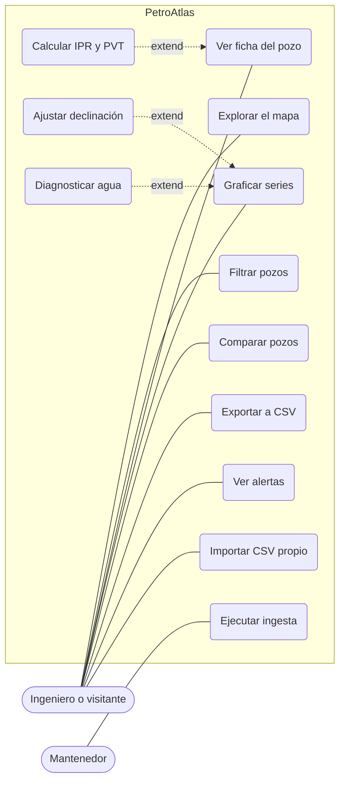
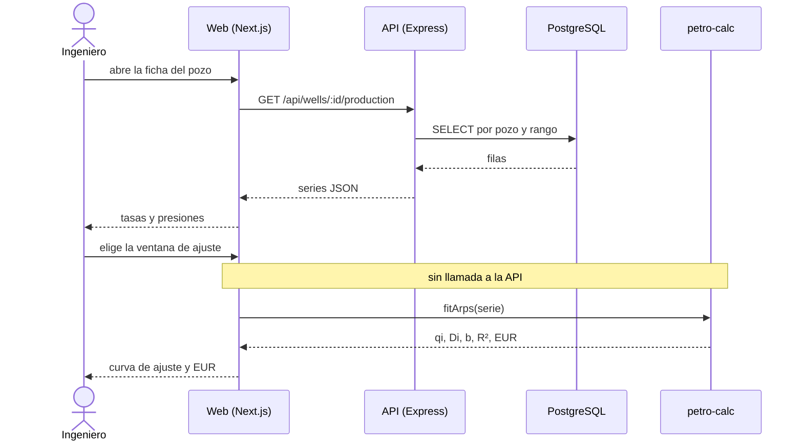

# Casos de uso

Todo parte del mapa; las herramientas de ingeniería extienden la ficha del pozo.

Las líneas continuas son asociaciones del actor con cada caso. Las flechas punteadas son relaciones «extend»: IPR y PVT parten de la ficha del pozo; la declinación y el diagnóstico de agua, de las series graficadas.

## Detalle

| Caso | Actor | Disparador | Resultado | Requisito |
| --- | --- | --- | --- | --- |
| Explorar el mapa | Visitante | Abre la aplicación | Ve pozos agrupados y capas de campos | RF-01 |
| Filtrar pozos | Visitante | Cambia un filtro | El mapa y el conteo se actualizan; la URL refleja el filtro | RF-02, RF-15 |
| Ver ficha del pozo | Visitante | Hace clic en un pozo | Panel con metadatos, trayectoria y pestañas de gráficas | RF-03 |
| Graficar series | Visitante | Abre una pestaña de la ficha | Gráficas sincronizadas de producción y operación | RF-04, RF-05 |
| Comparar pozos | Visitante | Añade un segundo pozo a la comparación | Series superpuestas con leyenda por pozo | RF-10 |
| Exportar a CSV | Visitante | Pulsa exportar | Descarga las series visibles | RF-12 |
| Ver alertas | Visitante | Abre el panel de alertas o un pozo resaltado | Lista de alertas con nivel y explicación | RF-13 |
| Importar CSV propio | Visitante | Arrastra un archivo | Los pozos aparecen como capa aparte; errores por línea | RF-14 |
| Calcular IPR y PVT | Ingeniero | Abre la pestaña Ingeniería | Curvas que responden al mover los parámetros | RF-08 |
| Ajustar declinación | Ingeniero | Selecciona una ventana en la gráfica de tasa | Ajuste de Arps, pronóstico y EUR | RF-07 |
| Diagnosticar agua | Ingeniero | Abre la pestaña Diagnóstico | Gráfico de Chan en log-log | RF-09 |
| Ejecutar ingesta | Mantenedor | Corre el ETL | Datos públicos actualizados; registro de la corrida | — |

## Flujo principal: ajuste de declinación

La red interviene una sola vez, para traer las series. A partir de ahí, cada cambio recalcula en el navegador.

