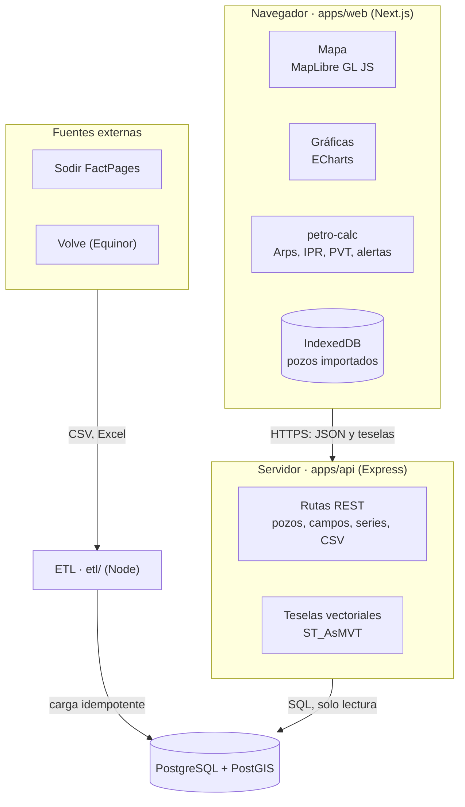

# Arquitectura

Tres capas más un proceso de ingesta independiente. La web pide datos a la API y calcula en el cliente con `petro-calc`. El ETL es el único componente que escribe en la base de datos.



## Stack

| Capa | Tecnología | Motivo |
| --- | --- | --- |
| Frontend | Next.js (App Router) + TypeScript | Rutas por pozo y campo, renderizado en servidor para las fichas |
| Mapa | MapLibre GL JS | Código abierto, sin token, soporta teselas vectoriales y clustering |
| Gráficas | ECharts | Series largas con zoom sincronizado y ejes logarítmicos |
| Estado de URL | Parámetros de búsqueda de Next.js | Vistas compartibles sin librería extra |
| Almacenamiento local | IndexedDB | Pozos importados que no salen del navegador |
| API | Express 5 + Zod | Validación de parámetros y tipos compartidos con la web |
| Acceso a datos | SQL parametrizado con `pg` | Las consultas espaciales y de teselas son SQL directo |
| Base de datos | PostgreSQL 16 + PostGIS | Consultas por área visible y generación de teselas |
| Ingesta | Scripts Node + TypeScript | Mismo lenguaje y tipos que el resto del repositorio |
| Pruebas | Vitest + Playwright | Unitarias para los cálculos, extremo a extremo para el mapa |
| Calidad | ESLint + Prettier + `tsc --noEmit` | Un solo estilo en todo el monorepo |
| CI | GitHub Actions | Lint, tipos, pruebas y build en cada push |
| Despliegue | Docker Compose | Un comando levanta todo el entorno |

Las versiones exactas se fijan al crear el repositorio, usando la versión LTS vigente de Node y las últimas estables de cada librería, y quedan registradas en `package.json`.

## Estructura del repositorio

```text
petroatlas/
├── apps/
│   ├── web/            Next.js: mapa, ficha de pozo, herramientas
│   └── api/            Express: rutas, consultas SQL, teselas
├── packages/
│   ├── petro-calc/     Cálculos de ingeniería + pruebas
│   └── shared-types/   Tipos y esquemas Zod compartidos
├── etl/                Descarga, normalización y carga de datos
├── db/
│   ├── migrations/     SQL versionado
│   └── seed/           Datos de ejemplo para desarrollo
├── data/               Descargas del ETL (ignorada por Git)
├── docs/               Esta documentación
├── docker-compose.yml
└── README.md
```

## Reglas de dependencia

- `packages/petro-calc` no importa nada del resto del repositorio ni de librerías de interfaz. Es TypeScript puro y publicable en npm.
- `packages/shared-types` solo depende de Zod.
- `apps/web` importa `petro-calc` y `shared-types`. Nunca accede a la base de datos.
- `apps/api` importa `shared-types`. No importa `petro-calc`: los cálculos no se hacen en el servidor.
- `etl` importa `shared-types` y escribe en la base de datos. La API se conecta con un usuario de solo lectura.

## Flujo de una petición del mapa

1. El usuario mueve el mapa. El evento se agrupa con un retardo de unos 200 ms.
2. Con zoom bajo, el mapa pide teselas vectoriales a `/api/tiles/wells/{z}/{x}/{y}.mvt`.
3. La API genera cada tesela con `ST_AsMVT` y responde con cabeceras de caché.
4. Al hacer clic en un pozo, la web pide `/api/wells/:id` y abre la ficha.
5. Las capas de campos y de instalaciones solo se muestran a partir de un nivel de zoom, para no saturar la vista general.

## Decisiones registradas

Las decisiones que dieron forma a esta arquitectura están en [adr/](adr/README.md).
