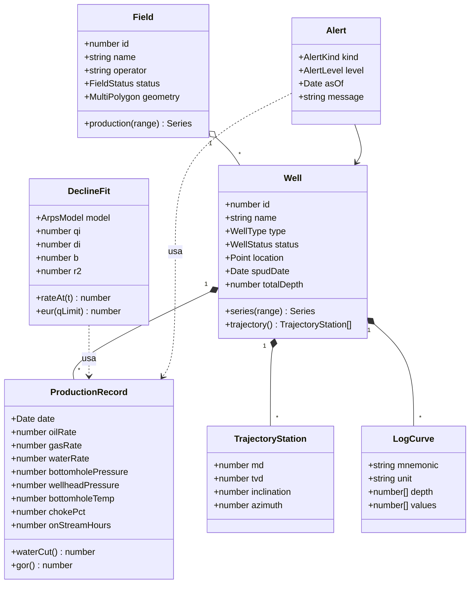

# Modelo de dominio

El pozo es el agregado central; los cálculos dependen solo de sus series.



Rombo relleno: composición. Rombo vacío: agregación. Flecha punteada: dependencia.

## Qué se persiste y qué no

| Clase | Dónde vive | Nota |
| --- | --- | --- |
| `Field`, `Well`, `ProductionRecord`, `TrajectoryStation`, `LogCurve` | PostgreSQL | Cargadas por el seed sintético |
| `Alert` de pozos públicos | Vista `well_alert` | Se calcula al consultar |
| `Alert` de pozos importados | Memoria del navegador | La calcula `petro-calc/alerts` |
| `DeclineFit`, curvas IPR y PVT | Memoria del navegador | Se construyen a partir de una serie y viven mientras dura la sesión |
| Pozos importados | IndexedDB | Nunca se envían al servidor |

## Enumeraciones

```ts
export type WellType = 'producer' | 'injector' | 'exploration' | 'observation';
export type WellStatus = 'producing' | 'injecting' | 'shut_in' | 'abandoned' | 'unknown';
export type FieldStatus = 'producing' | 'shut_down' | 'approved' | 'unknown';
export type ArpsModel = 'exponential' | 'hyperbolic' | 'harmonic';
export type AlertKind = 'production_drop' | 'high_water_cut' | 'no_production';
export type AlertLevel = 'warning' | 'critical';
```

Los valores de estado se asignan en el seed. El valor original se conserva en una columna de texto aparte si hace falta para depurar.

## Tipos compartidos

Los tipos anteriores y los esquemas Zod que validan las respuestas de la API viven en `packages/shared-types`. La web y la API importan el mismo esquema, de modo que un cambio en la forma de una respuesta rompe la compilación en ambos lados.
