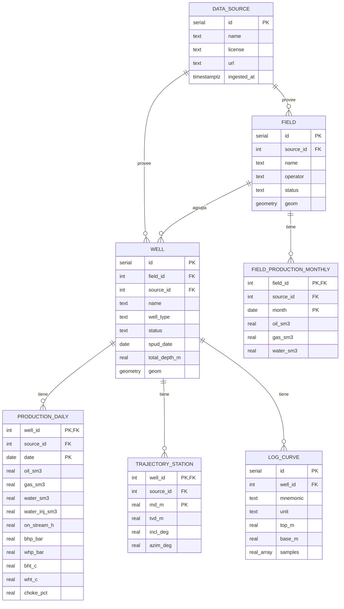

# Base de datos

Siete tablas y una vista. Todo cuelga de `well`, y `production_daily` concentra tasas, presiones y choke.



## Reglas del esquema

- Las columnas llevan la unidad en el nombre: `oil_sm3`, `bhp_bar`, `bht_c`.
- `production_daily`, `field_production_monthly` y `trajectory_station` guardan su `source_id`, para que la interfaz muestre la fuente y la licencia de cada serie (RNF-02).
- Un dato ausente es `NULL`, nunca cero. Un cero significa que se midió cero.
- Las series usan clave compuesta (pozo, fecha), lo que hace la ingesta idempotente con `ON CONFLICT`.
- Las geometrías están en EPSG:4326. Las fuentes que publican en otro datum (Sodir usa ED50, EPSG:4230) se transforman al cargar.
- `well.slug` y `field.slug` son columnas generadas a partir de `name`, con índice único: el identificador legible que usa la URL (`15/9-F-12` → `15-9-F-12`, `VOLVE` → `volve`). Las añade `0002_slugs.sql`; nadie las escribe a mano.
- `production_daily` guarda volúmenes del día, no tasas. La tasa diaria es el volumen del día; la tasa en flujo se obtiene dividiendo entre `on_stream_h / 24`.
- Las curvas de registro guardan sus muestras en un arreglo con paso de profundidad constante entre `top_m` y `base_m`. Evita millones de filas por pozo y basta para un visor.

## DDL

```sql
CREATE EXTENSION IF NOT EXISTS postgis;

CREATE TABLE data_source (
  id          serial PRIMARY KEY,
  name        text NOT NULL UNIQUE,
  license     text NOT NULL,
  url         text NOT NULL,
  ingested_at timestamptz
);

CREATE TABLE field (
  id        serial PRIMARY KEY,
  source_id int  NOT NULL REFERENCES data_source(id),
  name      text NOT NULL,
  operator  text,
  status    text,
  geom      geometry(MultiPolygon, 4326)
);

CREATE TABLE well (
  id            serial PRIMARY KEY,
  field_id      int  REFERENCES field(id),
  source_id     int  NOT NULL REFERENCES data_source(id),
  name          text NOT NULL,
  well_type     text CHECK (well_type IN ('producer','injector','exploration','observation')),
  status        text,
  spud_date     date,
  total_depth_m real,
  geom          geometry(Point, 4326) NOT NULL,
  UNIQUE (source_id, name)
);

CREATE TABLE production_daily (
  well_id       int  NOT NULL REFERENCES well(id) ON DELETE CASCADE,
  source_id     int  NOT NULL REFERENCES data_source(id),
  date          date NOT NULL,
  oil_sm3       real,
  gas_sm3       real,
  water_sm3     real,
  water_inj_sm3 real,
  on_stream_h   real,
  bhp_bar       real,
  whp_bar       real,
  bht_c         real,
  wht_c         real,
  choke_pct     real,
  PRIMARY KEY (well_id, date)
);

CREATE TABLE field_production_monthly (
  field_id  int  NOT NULL REFERENCES field(id) ON DELETE CASCADE,
  source_id int  NOT NULL REFERENCES data_source(id),
  month     date NOT NULL,
  oil_sm3   real,
  gas_sm3   real,
  water_sm3 real,
  PRIMARY KEY (field_id, month)
);

CREATE TABLE trajectory_station (
  well_id   int  NOT NULL REFERENCES well(id) ON DELETE CASCADE,
  source_id int  NOT NULL REFERENCES data_source(id),
  md_m      real NOT NULL,
  tvd_m    real NOT NULL,
  incl_deg real,
  azim_deg real,
  PRIMARY KEY (well_id, md_m)
);

CREATE TABLE log_curve (
  id       serial PRIMARY KEY,
  well_id  int  NOT NULL REFERENCES well(id) ON DELETE CASCADE,
  mnemonic text NOT NULL,
  unit     text,
  top_m    real NOT NULL,
  base_m   real NOT NULL,
  samples  real[] NOT NULL,
  UNIQUE (well_id, mnemonic)
);

CREATE INDEX well_geom_idx   ON well  USING gist (geom);
CREATE INDEX field_geom_idx  ON field USING gist (geom);
CREATE INDEX well_field_idx  ON well (field_id);
CREATE INDEX well_status_idx ON well (status, well_type);
```

## Vista de alertas

Las alertas de los pozos públicos no ocupan tabla: una vista las calcula sobre `production_daily`. La API la cruza con `well` para limitar la regla de pozo sin producción a los productores activos, y añade el nivel de alerta como propiedad de cada pozo en el GeoJSON.

Como los datos son históricos, las reglas se evalúan respecto a la última fecha con datos de cada pozo.

```sql
CREATE VIEW well_alert AS
WITH last AS (
  SELECT well_id, max(date) AS d
  FROM production_daily
  GROUP BY well_id
),
agg AS (
  SELECT p.well_id,
    avg(p.oil_sm3)   FILTER (WHERE p.date >  l.d - 7)                       AS oil_7d,
    avg(p.oil_sm3)   FILTER (WHERE p.date <= l.d - 7 AND p.date > l.d - 37) AS oil_prev30,
    sum(p.oil_sm3)   FILTER (WHERE p.date >  l.d - 7)                       AS oil_sum_7d,
    sum(p.water_sm3) FILTER (WHERE p.date >  l.d - 7)                       AS water_sum_7d,
    sum(coalesce(p.oil_sm3, 0) + coalesce(p.gas_sm3, 0))
                     FILTER (WHERE p.date >  l.d - 3)                       AS prod_3d,
    l.d AS as_of
  FROM production_daily p
  JOIN last l USING (well_id)
  GROUP BY p.well_id, l.d
)
SELECT well_id, as_of, oil_7d, oil_prev30,
  water_sum_7d / nullif(water_sum_7d + oil_sum_7d, 0) AS water_cut_7d,
  prod_3d,
  CASE
    WHEN oil_prev30 > 0 AND oil_7d < 0.50 * oil_prev30 THEN 'critical'
    WHEN oil_prev30 > 0 AND oil_7d < 0.75 * oil_prev30 THEN 'warning'
  END AS production_drop,
  water_sum_7d / nullif(water_sum_7d + oil_sum_7d, 0) > 0.80 AS high_water_cut,
  prod_3d = 0 AS no_production
FROM agg;
```

Los umbrales de la vista deben coincidir con los valores por defecto de `petro-calc/alerts`. Si se cambian en un lado, se cambian en el otro en el mismo PR. Si el cálculo resulta lento con muchos pozos, la vista pasa a ser materializada y el ETL la refresca al terminar.

## Migraciones

- Cada cambio de esquema es un archivo SQL nuevo en `db/migrations/`, numerado: `0001_init.sql`, `0002_slugs.sql`.
- Una migración publicada no se edita; se corrige con otra.
- Las migraciones solo avanzan. Para deshacer en desarrollo se recrea la base de datos.
- `0001_init.sql` contiene exactamente el DDL de este documento. Las migraciones posteriores se describen en las reglas del esquema.
- El ejecutor (`db/scripts/migrate.ts`, `pnpm db:migrate`) aplica en orden los archivos pendientes, cada uno en su transacción, y los anota en la tabla `schema_migrations` con su suma de comprobación. Si un archivo ya aplicado cambia, el ejecutor se detiene. Esa tabla es del ejecutor, no del modelo de datos.

## Usuarios de base de datos

| Usuario | Permisos | Quién lo usa |
| --- | --- | --- |
| `petroatlas_etl` | Lectura y escritura | ETL y migraciones |
| `petroatlas_api` | Solo `SELECT` | API |

Los usuarios no se crean en una migración, porque sus contraseñas vienen del entorno: los crea `db/init/20-petroatlas-roles.sh` cuando el contenedor de PostgreSQL inicializa la base de datos. El mismo script instala PostGIS, que exige superusuario, y deja privilegios por defecto para que toda tabla creada por `petroatlas_etl` sea legible, y solo legible, por `petroatlas_api`.
